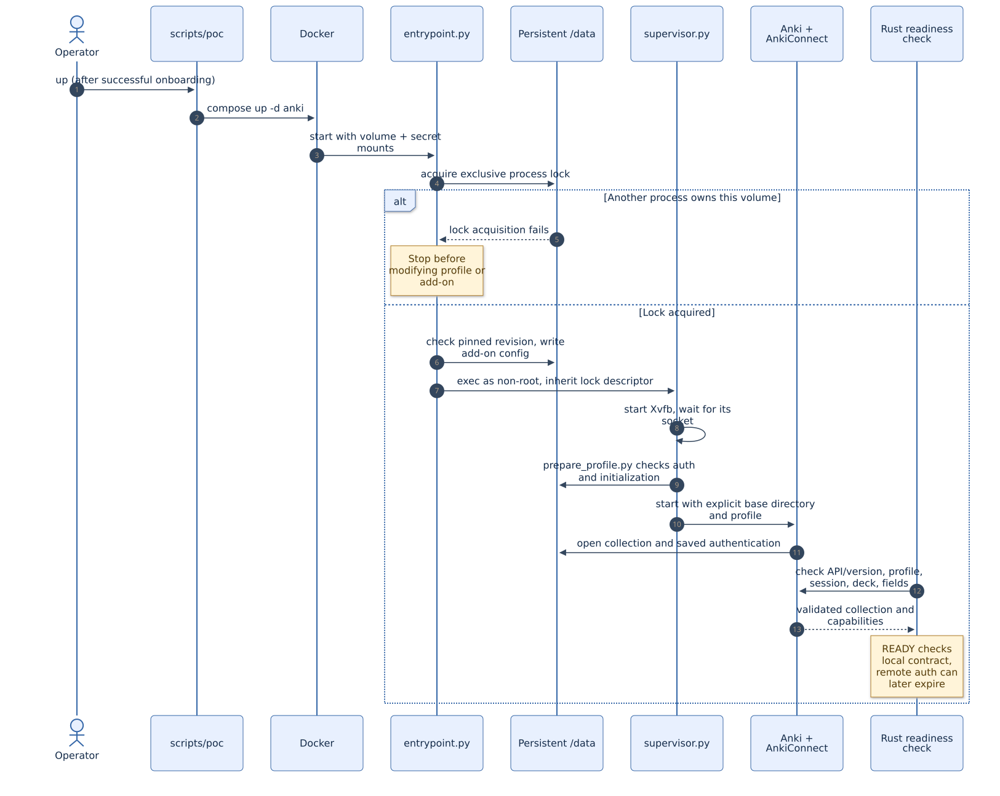
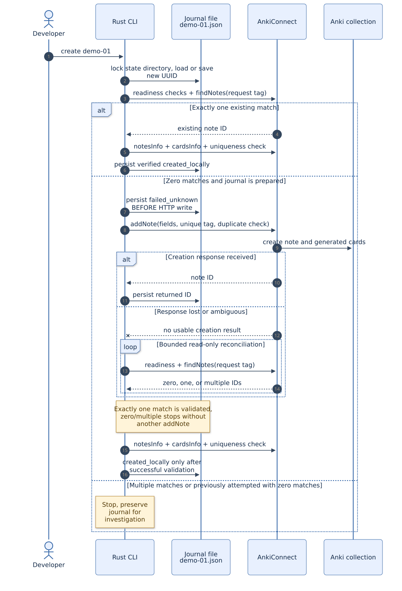
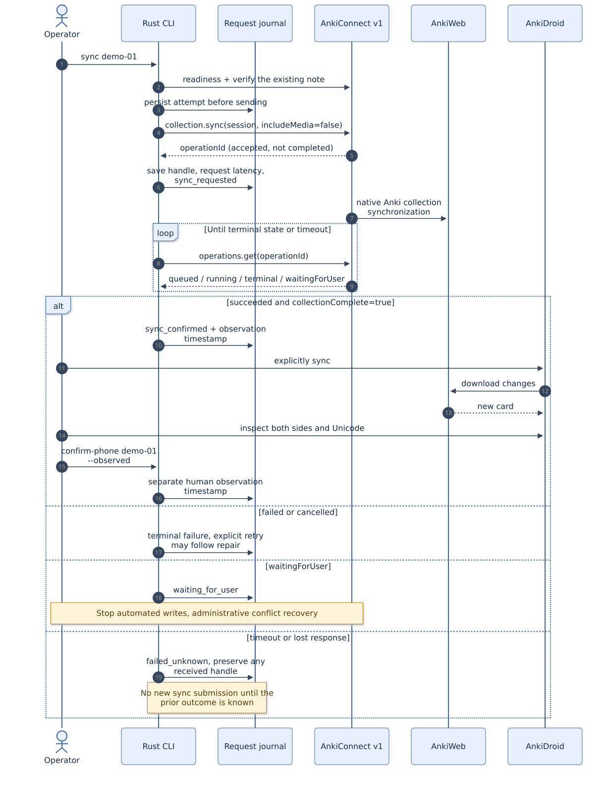
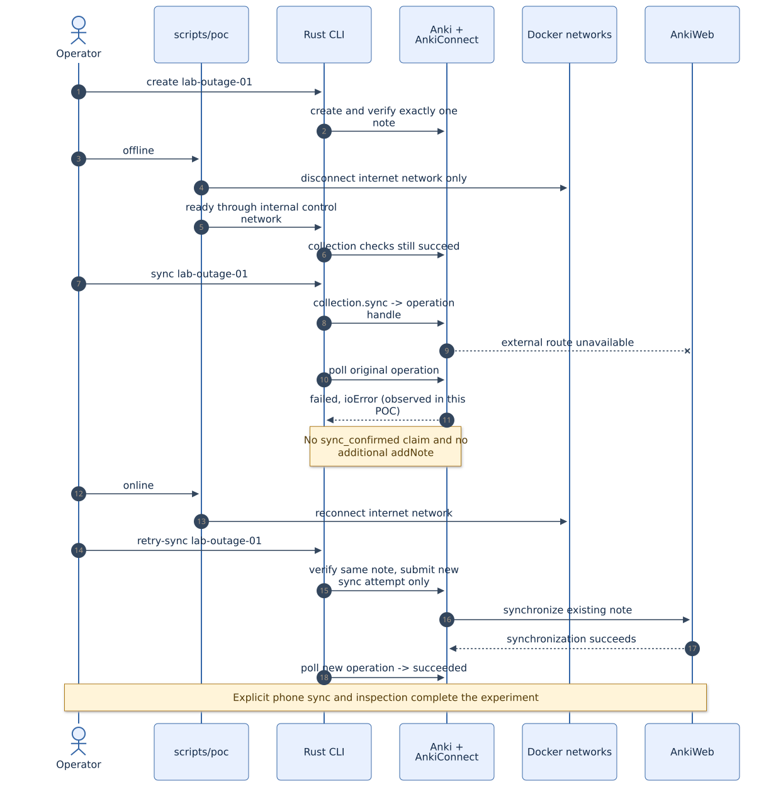

# Anki POC: architecture, code paths, and hands-on walkthrough

This guide explains the implemented POC for a developer learning Python or Rust.
For credential provisioning and multiple isolated users, see [unattended onboarding](onboarding.md).
Read the [original results](results.md) and [onboarding results](onboarding-results.md) for measured outcomes, and the [README](../README.md)
for the shorter operating instructions. The examples below use new labels so they
do not alter the original A–D experiment records.

The working pipeline creates a synthetic note in a dedicated Anki collection,
verifies it, asks Anki to synchronize with AnkiWeb, and records a separate human
check on the phone. It does not edit or delete existing notes.

**Reading order:** [components](#1-components-and-storage) → [source map](#2-where-to-read-the-code)
→ [startup](#3-startup-and-shutdown) → [creation](#4-how-note-creation-works)
→ [sync](#5-how-synchronization-works) → [walkthrough](#6-run-the-poc-step-by-step)
→ [tests](#7-testing-from-smallest-to-largest) → [troubleshooting](#8-troubleshooting)
→ [diagram sources](#9-editing-and-rendering-the-diagrams).

## 1. Components and storage


[Editable Mermaid source](diagrams/01-runtime.mmd). Solid arrows represent runtime
calls or data flow; dotted arrows show secret provisioning. AnkiConnect is an
add-on **inside the Anki Desktop process**, not a separate application server.

| Component | Responsibility | Lifetime |
|---|---|---|
| `scripts/poc` | Run Docker commands and group common experiment steps | One command |
| Rust `anki-poc` CLI | Validate readiness, create/read notes, observe sync, save evidence | One command |
| Anki container | Keep Anki and its virtual display running | Between start and stop |
| AnkiConnect | Translate authenticated HTTP requests into Anki operations | Same as Anki |
| Xvfb | Supply a virtual screen for the desktop application | Same container session |
| Python onboarding command | Backend login and first download without a display | One provisioning invocation |
| AnkiWeb | Synchronize collections between Anki clients | External service |
| Test phone | Download the changes and provide independent delivery evidence | User-operated |

### Three different places store data

| Location | Contents | Why it matters |
|---|---|---|
| Docker named volume `anki-poc_anki-data`, mounted at `/data` | Collection, profiles, media, add-ons/config, sync authentication | Removing a container must not remove the collection or login |
| Host `.state/`, mounted at `/state` in the CLI container | One JSON request journal per label, plus `driver.lock` | A new CLI process can resume the same request safely |
| Host `.secrets/`, mounted as Compose secret files | AnkiConnect API key and short-lived onboarding credential file | Keeps local secrets out of code, image build context, and command-line arguments |

The journal is **not a replica of the Anki database**. It tracks the POC's synthetic
requests; Anki remains responsible for collection storage and synchronization.
AnkiWeb authentication is saved by Anki in its own profile, not in `.env`.

`/run/poc` is now a private **tmpfs** holding runtime copies of secrets. It is
recreated on container start. Onboarding additionally writes an account binding
and sanitized status under `/data`; see [the provisioning state machine](onboarding.md#code-path-and-state).

### Two networks make the outage experiment possible

- **Control:** an internal Docker network connects the driver to `http://anki:8765`.
  The name `anki` is the Compose service name resolved by Docker's DNS.
- **Internet:** a separate bridge gives Anki access to AnkiWeb. Experiment D detaches
  this network while retaining control access.

Inside a container, `localhost` means **that container**. Therefore the CLI container
uses `anki:8765`; a CLI running directly on the host uses `127.0.0.1:8765`.
AnkiConnect listens on container `0.0.0.0`, while Compose publishes its host port
only on `127.0.0.1`. The local API still requires its generated key.

The presentation bridge and host port 6080 were removed. Only the authenticated
API is published. Xvfb is still required internally by Anki/Qt, but no VNC server
or window manager runs. `exposure` verifies missing/wrong API keys are rejected
and no listeners exist on 5900/6080.

## 2. Where to read the code



[Editable Mermaid source](diagrams/02-code-map.mmd). Orange boxes are Rust; blue
boxes are Python. The Rust functions remain in one small executable rather than
being split into multiple modules. Boxes group responsibilities, not separate services.

| File | Start reading here | What to notice |
|---|---|---|
| [src/main.rs](../src/main.rs) | `main()` → `run()` | Command dispatch, journal lock, load/create record |
| Same Rust file | `Api::new`, `call`, `rpc`, `ready_once` | Configuration, two HTTP formats, real collection readiness |
| Same Rust file | `Record`, `SyncAttempt`, `save`, `load` | Persistent request identity and state |
| Same Rust file | `create`, `reconcile`, `verify` | Duplicate prevention and exact readback |
| Same Rust file | `sync`, `poll_sync` | Acceptance versus completion; terminal-only retry |
| [scripts/poc](../scripts/poc) | Dispatch after `args = sys.argv[1:]` | Python executable without a `.py` extension; delegates to Docker |
| [scripts/init.py](../scripts/init.py) | Directory/secret creation loops | Secure random values and preserve-existing-file behavior |
| [container/entrypoint.py](../container/entrypoint.py) | Volume lock, then configuration | Runs briefly as root, then switches to ordinary user `anki` |
| [container/supervisor.py](../container/supervisor.py) | Startup, main loop, shutdown | Child process lifetimes, signals and bounded waits |
| [container/prepare_profile.py](../container/prepare_profile.py) | `ProfileManager` calls | Existing profile is reused; credentials are retained |
| [container/onboarding.py](../container/onboarding.py) | `provision`, `check_binding`, `initialize_collection` | Account isolation, backend login, download-only initialization |
| [scripts/credentials.py](../scripts/credentials.py) | Host terminal prompts | Secret input without shell arguments or GUI |
| [container/check_exposure.py](../container/check_exposure.py) | Missing/wrong-key loop | Negative authentication tests for both API contracts |
| [tests/test_driver.py](../tests/test_driver.py) | `setUp`, `Handler`, `cli`, test methods | Real Rust executable talking to a controllable fake server |
| [scripts/export_evidence.py](../scripts/export_evidence.py) | Fixed A–D label loop | Copies synthetic request evidence, not secrets |
| [scripts/capture_operations.py](../scripts/capture_operations.py) | Per-operation loop | Captures only allowlisted status/error metadata |

### Rust vocabulary used in this project

| Syntax | Meaning in this code |
|---|---|
| `Result<T>` | Return either a successful value of type `T` or an error |
| `?` | Continue with the successful value, or return the error to the caller |
| `ensure!(condition, message)` | Return an error when a required condition is false |
| `Option<u64>` | A numeric value may be known (`Some(id)`) or missing (`None`) |
| `&Record` / `&mut Record` | Borrow the existing record for reading / changing |
| `.clone()` | Make an owned copy when the original is still needed elsewhere |
| `Value`, `json!`, Serde derives | Read/write JSON and convert Rust structs to/from JSON |
| `match` / `if let` | Handle different outcomes explicitly, such as success/error or present/missing |
| `SystemTime` versus `Instant` | Calendar timestamps for evidence versus elapsed-time clocks for deadlines |

Python's `with` closes resources automatically when a block exits. In Rust, a
value's `Drop` cleanup runs when it goes out of scope. The driver's lock `File`
stays in scope for the whole command, so the OS releases its lock on exit, including
after an error. The persistent lock **file** can remain; an existing filename does
not mean a process is still holding the OS lock.

## 3. Startup and shutdown



[Editable Mermaid source](diagrams/03-startup.mmd).

The image is built in two stages. A pinned Rust image compiles the release binary;
a pinned Python image installs Anki, Qt, the exact AnkiConnect revision, and display
dependencies. The resulting runtime image includes the compiled CLI, so a host
Rust installation is unnecessary for normal use.

At runtime, `entrypoint.py` takes an exclusive lock on `/data/.process.lock` before
changing add-on files. It writes the effective AnkiConnect configuration, prepares
permissions, and uses `gosu` to replace itself with the non-root supervisor. The
open lock descriptor is inherited across that replacement. This is a **different
lock** from the CLI's `.state/driver.lock`:

| Lock | Prevents | Does not prevent |
|---|---|---|
| `/data/.process.lock` | Two POC Anki processes using one data volume | Two independent CLI writers |
| `.state/driver.lock` | Overlapping CLI commands using the same journal directory | Writers using another directory or bypassing this CLI |

The one-shot onboarding mode runs before Desktop and does not need Xvfb. For normal
service mode, the supervisor starts Xvfb, checks the saved profile and completed
initialization, then launches Anki. Its loop monitors required child processes.
There is no presentation bridge or runtime GUI toggle.

On Docker stop, a signal handler sets a flag. The supervisor then requests
`guiExitAnki`, waits for Anki to close its collection, and stops the display helpers.
The runner checks the final container exit code before proceeding with recreation.
This is why `scripts/poc recreate` is preferable to forcibly killing the service.

`ready` checks the open collection, expected profile/deck/fields, pinned Anki version,
and required API capabilities. It does **not** prove AnkiWeb authentication or phone
delivery. A saved authentication key may later become invalid even while local readiness passes.

## 4. How note creation works



[Editable Mermaid source](diagrams/04-create.mmd).

Trace this command through the code:

```sh
scripts/poc driver create learn-01
```

1. Python `driver()` runs a disposable Compose CLI container.
2. Rust `run()` validates the label and takes `.state/driver.lock`.
3. It loads `.state/learn-01.json`, or `Record::new()` generates a UUID and `save()`
   persists it before any note creation request.
4. `create()` checks readiness and searches the exact `poc_request_<UUID>` tag.
5. One existing match goes to `verify()`. Multiple matches stop. Zero matches allow
   a write only if the record is still `prepared`.
6. The driver persists `failed_unknown` **before** `addNote`. This deliberately
   covers a crash in the interval between saving intent and receiving the result.
7. A returned note ID is saved. `verify()` checks the note fields, tags, generated
   cards, deck and uniqueness before recording `created_locally`.

Why save an unknown state before sending? Imagine Anki creates a note, but the
connection closes before the response reaches the CLI. The client cannot distinguish
that from a request which never arrived. Sending another `addNote` could create a
duplicate. `reconcile()` searches instead and stops if the outcome remains uncertain.

Even a crash **before the request was actually sent** can require manual diagnosis.
This POC accepts that inconvenience to avoid guessing. It is not a general guarantee
of exactly-once execution across arbitrary clients or deleted journals.

### Request identity has several parts

| Identifier | Example | Purpose |
|---|---|---|
| Label | `learn-01` | Human-friendly CLI argument and journal filename |
| Request UUID | Generated 32-character hexadecimal value | Stable identity reused on retries |
| Anki tag | `poc_request_<UUID>` | Locate the request's note in Anki |
| Anki note ID | Integer returned by `addNote` | Verify the same note on later reads |
| Sync operation ID | Opaque handle returned by the v1 endpoint | Observe one server-side sync attempt |

Do not delete a journal to make a retry succeed, and do not choose a new label to
retry an ambiguous request. A new label means a genuinely new synthetic note.

### Atomic journal writes

`save()` serializes the `Record` into a temporary file in the same directory,
flushes it with `sync_all()`, renames it over the destination, and flushes the
directory. A reader sees complete old JSON or complete new JSON. The shared CLI
lock prevents two commands from using the same temporary filename simultaneously.

## 5. How synchronization works



[Editable Mermaid source](diagrams/05-sync.mmd).

The pinned add-on supports two different HTTP protocols. Keeping their envelopes
separate makes error handling clearer:

| | Legacy API v6 | Current v1 endpoint |
|---|---|---|
| Path | `/` | `/api/v1` |
| Rust helper | `Api::call` | `Api::rpc` |
| Request name | `action` | `method` |
| Authentication | JSON `key` property | `Authorization: Bearer …` header |
| Used here for | Note creation/readback and readiness checks | Collection session/capabilities and observable sync |
| Response validation | `result` and `error`; error must be null | Matching JSON-RPC envelope/id, no error, result present |

Illustrative payloads below contain placeholders, not real credentials. The CLI
reads the API key from a file; you do not need to paste it into a shell command.

```json
{
  "action": "findNotes",
  "version": 6,
  "key": "<read from the local API-key file>",
  "params": {"query": "tag:poc_request_<saved UUID>"}
}
```

```json
{
  "jsonrpc": "2.0",
  "id": 1,
  "method": "collection.sync",
  "params": {"includeMedia": false, "session": "<current collection session>"}
}
```

The JSON-RPC `id` matches one response to its request. It is **not** a duplicate
prevention key. The returned `operationId` identifies asynchronous server work.
`poll_sync()` repeatedly calls `operations.get` for that same handle; it does not
start a fresh sync on each poll.

### State and the correct next action

| Persisted value | What we know | Next action |
|---|---|---|
| `creation: prepared` | UUID saved; no write attempt recorded | `create LABEL` may submit a note |
| `creation: failed_unknown` | Creation attempted, but not fully verified | `reconcile LABEL`; no blind repost |
| `creation: created_locally` | Exact note/cards read back successfully | `sync LABEL` may start a first sync |
| Sync `sync_requested` | Handle received; work queued or running | Observe the same handle |
| Sync `failed_unknown` with a handle | Completion observation is uncertain | `sync-status LABEL`; no retry yet |
| Sync `failed_unknown` without a handle | Submission may have been accepted | Manual diagnosis; CLI refuses resubmission |
| Sync `waiting_for_user` | Server is waiting for an interactive decision | Stop automated writes; follow [administrative recovery](onboarding.md#errors-and-recovery) |
| Sync `failed` / `cancelled` | Terminal unsuccessful outcome observed | Repair the cause, then `retry-sync LABEL` |
| Sync `sync_confirmed` | Operation succeeded with `collectionComplete=true` | Explicitly sync and inspect phone |
| `phone_observed_at_ms` populated | A person reported successful inspection | Retain as separate delivery evidence |

Repeated `sync LABEL` returns immediately for a locally recorded confirmed attempt.
It does not guarantee the remote operation record still exists. Upstream handles
are lost on Anki restart and can expire; the local journal preserves what this
driver already observed. `show LABEL` reads that journal without contacting Anki,
although the CLI still loads its API configuration/key before dispatching `show`.

### Timeouts and measurements

Individual HTTP calls are bounded to five seconds. Readiness retries for approximately
60 seconds, creation reconciliation for approximately 20 seconds, and sync observation
for approximately 60 seconds. A final in-progress HTTP call or multi-call readiness
check can extend the outer deadline. Polling is not proof of completion; only the
validated response is evidence. A client timeout does not cancel server work.

`request_latency_ms` measures the sync submission call. `confirmed_at_ms` records
when polling observed completion. `phone_observed_at_ms` records a human report,
not the exact instant the phone downloaded a card. These are three different events.

## 6. Run the POC step by step

Run examples from the project root:

```sh
cd /home/bakterian/_SRC/10xDevsV4.0/0_AnkiDeckEditorPOC
```

The original POC is already configured and tested. Start with the **daily workflow**
below when using that existing setup. The first-install recipe is for a new checkout
or host. All `create`/`smoke` examples add synthetic cards to the test collection.

### First installation on another host

```sh
scripts/poc init
scripts/poc build
scripts/poc credentials
scripts/poc onboard
scripts/poc up
scripts/poc driver ready
scripts/poc exposure
```

`credentials` collects account details on the host with hidden password input.
`onboard` uses Anki's backend API, saves authentication, initializes the collection
with Download, and removes the host password file on success. The service never
needs a VNC login. Existing authenticated POC volumes can skip `credentials` and
`onboard`. Detailed requirements, multi-user examples and failure handling are in
[the onboarding guide](onboarding.md).

Expected: onboarding status `ready`, then local readiness and exposure `PASS`.
Anki/Qt are retained; VNC/noVNC, websockify and Openbox are removed. Upgrades of the
pinned backend API still require validation.

### Daily workflow: create, verify, sync, inspect

```sh
scripts/poc driver ready --once
scripts/poc driver create learn-01
scripts/poc driver verify learn-01
scripts/poc driver sync learn-01
scripts/poc driver show learn-01
```

Expected after creation: `creation` is `created_locally`, `note_id` is populated,
and `sync` is still empty. Expected after successful sync: the last attempt is
`sync_confirmed`. Now explicitly sync the test phone and inspect the card starting
`POC learn-01`, including both sides and the Unicode characters. Only then run:

```sh
scripts/poc driver confirm-phone learn-01 --observed
```

`create learn-01` again should reuse the same UUID and note ID. To create a different
synthetic card, use a new label such as `learn-02`. The CLI currently generates its
own fixed test text; it has no option for arbitrary front/back content.

### Useful operator commands

| Command | Effect / expected output |
|---|---|
| `scripts/poc smoke learn-02` | Readiness + create + exact readback; does not sync |
| `scripts/poc driver show learn-01` | Print its persisted request/evidence |
| `scripts/poc driver reconcile learn-01` | Search and validate after ambiguous creation; never add another note |
| `scripts/poc driver sync-status learn-01` | Observe the saved server operation; may fail if its handle expired |
| `scripts/poc credentials` | Collect a temporary account secret on the host |
| `scripts/poc onboard` | Authenticate/initialize while this user's service is stopped |
| `scripts/poc onboarding-status` | Print the last sanitized provisioning status |
| `scripts/poc restart` | Graceful stop/start of the same container, then readiness |
| `scripts/poc recreate` | Graceful stop, remove container, create it with retained volume |
| `scripts/poc stop` | Graceful stop with exit-code verification |
| `scripts/poc up` | Start/reconcile the Compose service; changed image/config may cause recreation |
| `scripts/poc doctor` | Print versions, image identity, service status and package inventory |
| `scripts/poc exposure` | Inspect localhost port publication; reject missing/wrong keys; check removed presentation listeners are absent |

Use `up` for deliberate lifecycle changes, not to inspect an active sync prompt.
A later collection conflict requires explicit administrative recovery; see the onboarding guide.
Do not use `docker compose down -v`: the `-v` option removes the data volume.

### Run the Rust binary directly on the host

Docker is the normal route and does not need a host Rust compiler. For development,
with Rust 1.90.0 installed and Anki already running:

```sh
cargo build --locked
export ANKI_URL=http://127.0.0.1:8765
export ANKI_API_KEY_FILE=.secrets/api-key
export ANKI_STATE_DIR=.state
export ANKI_PROFILE=POC
export ANKI_DECK=POC
export ANKI_MODEL=Basic
target/debug/anki-poc ready --once
target/debug/anki-poc show learn-01
```

The host CLI does not automatically load `.env`; Compose does. If configuration
differs from these defaults, export the matching values explicitly. Keep the same
`.state` directory for both routes so they share request identity and the CLI lock.

## 7. Testing from smallest to largest

### Level 1: Rust validation and Python syntax

```sh
cargo fmt -- --check
cargo test --locked
cargo clippy --locked --all-targets -- -D warnings
python3 -m compileall -q container scripts tests
docker compose config --quiet
```

The Rust unit test supplies one valid note response, then deliberately corrupts
fields/cards to prove validation rejects them. Python compilation only checks syntax;
it does not prove Docker, networking, or sync behavior.

### Level 2: fault injection without Anki or AnkiWeb

```sh
cargo build --locked
python3 -m unittest discover -s tests -v
```

The Python suite starts a local HTTP server on an automatically chosen port and
runs the actual compiled Rust CLI against it. Each test gets a temporary journal
directory and fake collection. It never uses your real `.state` or account.
The full suite includes a real 20-second reconciliation wait and usually takes
roughly 25 seconds on the tested machine.

Run just the lost-response case while developing:

```sh
PYTHONPATH=tests python3 -m unittest \
  test_driver.DriverTests.test_lost_creation_response_reuses_original -v
```

| Test scenario | What the fixture does | Required driver behavior |
|---|---|---|
| Repeat create/sync | Keeps prior fake state and counts submissions | One addNote and one sync submission |
| Lost creation response | Saves a note, closes connection before reply | Find/read the original, no second addNote |
| Rejected creation, zero matches | Rejects write and leaves collection empty | Stop after bounded reconciliation; no repost |
| Duplicate request tags | Returns two matching notes | Stop instead of guessing |
| Wrong active profile | Returns `Other` as the profile | Readiness fails |
| Full-sync prompt | Reports `waitingForUser` | No success or automatic retry |
| Failed sync, then recovery | First failure, later success | Retry sync only, keep one note |
| Lost sync acknowledgement | Accepts sync but drops its handle reply | Refuse a blind resubmission |
| Corrupted readback | Changes the returned field | Verification fails |
| Concurrent CLI | Python holds the shared file lock | Rust refuses the overlapping command |

Fixture tests prove client decisions, not live AnkiWeb behavior. The original
end-to-end run supplied that independent evidence; see [results](results.md).

### Level 3: live persistence, with new experiment labels

```sh
scripts/poc smoke lab-base-01
scripts/poc driver sync lab-base-01
# Explicit phone sync and inspection, then confirm-phone lab-base-01 --observed.

scripts/poc restart
scripts/poc driver verify lab-base-01
scripts/poc smoke lab-restart-01
scripts/poc driver sync lab-restart-01
# Repeat phone sync/inspection/confirmation for lab-restart-01.

scripts/poc recreate
scripts/poc driver verify lab-base-01
scripts/poc driver verify lab-restart-01
scripts/poc smoke lab-recreate-01
scripts/poc driver sync lab-recreate-01
# Repeat phone sync/inspection/confirmation for lab-recreate-01.
```

Passing means old notes remain, new notes are created exactly once, authentication
survives without login, and each newly synced card is confirmed on the phone.
The earlier labels remain usable for read-only `verify`/`show` commands.

### Level 4: controlled outage and recovery



[Editable Mermaid source](diagrams/06-outage.mmd).

Run this deliberately on the dedicated test container. The failed sync command
is expected to exit nonzero; do not join the entire recipe with `&&`, because that
would skip the connectivity-restoration command after the expected failure.

```sh
scripts/poc smoke lab-outage-01
scripts/poc offline
scripts/poc driver sync lab-outage-01
# Expected failure/unknown, while readiness through the control network works.
scripts/poc online
scripts/poc driver show lab-outage-01
```

Restore the internet network even if another step fails. If the last attempt is
still unknown/running, observe the original operation first:

```sh
scripts/poc driver sync-status lab-outage-01
```

Only once its recorded state is terminal `failed` or `cancelled`:

```sh
scripts/poc driver retry-sync lab-outage-01
scripts/poc driver verify lab-outage-01
# Explicit phone sync and inspection: exactly one card, correct both sides.
scripts/poc driver confirm-phone lab-outage-01 --observed
```

The observed original outage returned `ioError` after about 30 seconds. That is
an observation, not a guaranteed timeout. If restoration lets the original attempt
finish successfully, record that outcome instead; do not force an unnecessary retry.

### Evidence commands

```sh
scripts/poc doctor > /tmp/anki-poc-current-environment.txt
python3 scripts/export_evidence.py
python3 scripts/capture_operations.py
```

The exporter writes `docs/evidence.json` for exactly `A`, `C-restart`, `C-recreate`
and `D`, preserving the scope of the original report. Tutorial labels stay in their
individual `.state/<label>.json` files. The operation capture script visits saved
attempts and overwrites `docs/operations.json` with current observations. If you
need to retain an older snapshot, copy that report before running it again.

Missing historical operation handles do not invalidate already saved success.
They mean the current process cannot supply that old operation record. Never
translate an unavailable observation into a new success/failure claim.

## 8. Troubleshooting

| Symptom | Meaning | Action |
|---|---|---|
| Docker socket permission denied | Shell/session lacks access to the Docker daemon | Fix host Docker permissions; runner can use `sg docker` for newly granted membership |
| Expected deck missing after initial Download | Download replaced the empty pre-created collection | Onboarding ensures `POC` after download; inspect configured deck and initialization status |
| Unexpected fields or note type | Collection differs from the test contract | Check `Basic` with `Front`, `Back` in order; do not blindly modify an existing real collection |
| Another driver command is active | A process holds the journal lock | Let it finish; do not bypass it with a new state directory |
| Previous creation may have executed | There is a saved ambiguous attempt | Use `reconcile`; retain the journal if still uncertain |
| Multiple matches | The unique request tag is no longer unique | Stop and investigate; never pick an arbitrary note |
| Sync waiting for user | Native Anki needs a decision | Stop automation; see onboarding recovery instructions |
| Sync handle unavailable | Restart/expiry or lost acknowledgement prevents observation | Use saved evidence and administrative/phone diagnosis; do not automatically retry |
| Sync fails while API readiness passes | Local collection access works, but AnkiWeb sync does not | Check connectivity/login through maintenance; retry only after terminal failure |
| No setup page | Presentation servers were removed | Use `credentials` / `onboard` for authentication |
| Unclean shutdown reported | Runner cannot establish graceful collection closure | Inspect logs and preserve the volume before attempting recreation |

Application logs may contain diagnostic details; the committed evidence scripts
omit raw upstream error messages. AnkiWeb credentials are entered in Anki's login
dialog, never in tutorial commands. No script needs the password posted into chat.

## 9. Editing and rendering the diagrams

The seven diagrams are stored as editable `.mmd` files beside pre-rendered `.svg`
files in [diagrams/](diagrams/). The SVGs are scalable images and display without
a Mermaid plugin. The `.mmd` sources can also be placed inside a Markdown code
block labelled `mermaid` in a viewer that supports it.

This revision was rendered with `@mermaid-js/mermaid-cli` **12.0.0**, using
[mermaid-config.json](diagrams/mermaid-config.json) for consistent fonts/colors.
Rendering tools are development-only: the running POC needs neither Node nor a
browser renderer. One way to reproduce a diagram with Node/npm available is:

```sh
npm install --prefix /tmp/anki-poc-diagram-tools @mermaid-js/mermaid-cli@12.0.0
PUPPETEER_CACHE_DIR=/tmp/anki-poc-mermaid-browser \
  /tmp/anki-poc-diagram-tools/node_modules/.bin/puppeteer browsers install chrome
PUPPETEER_CACHE_DIR=/tmp/anki-poc-mermaid-browser \
  /tmp/anki-poc-diagram-tools/node_modules/.bin/mmdc \
  --size 1600 \
  -i docs/diagrams/01-runtime.mmd \
  -o docs/diagrams/01-runtime.svg \
  -c docs/diagrams/mermaid-config.json
```

Repeat the last command for another source filename. Browser startup requirements
depend on the rendering host; this tooling is separate from the Anki container.
No extra Codex plugin is needed to edit or view the provided diagrams.
