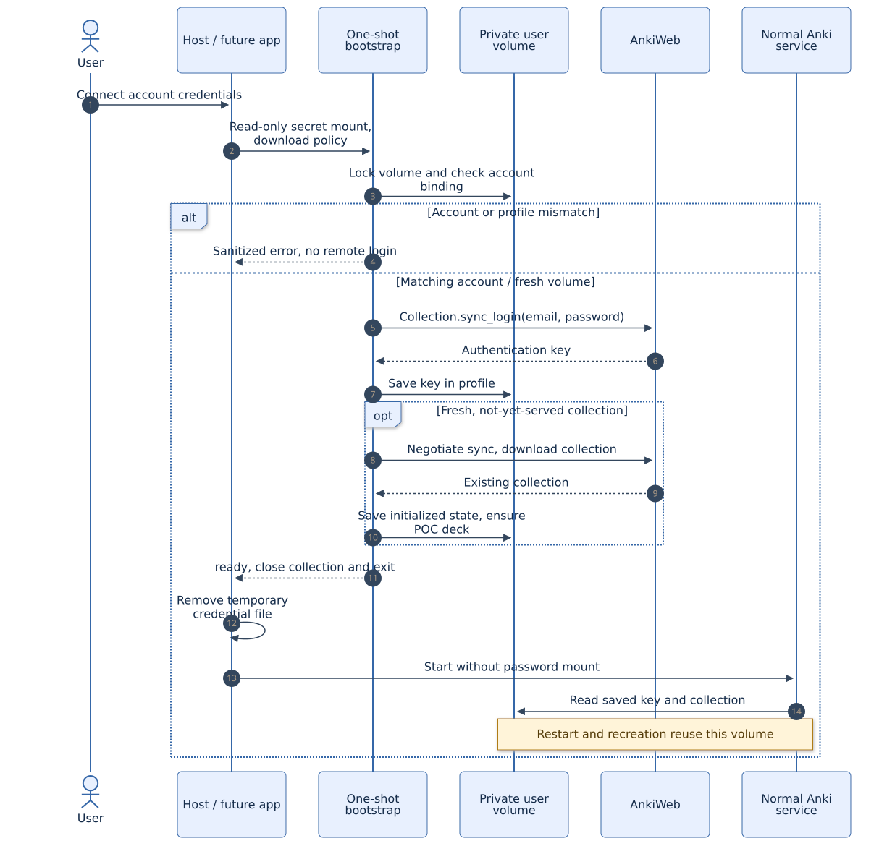

# Unattended AnkiWeb onboarding

The POC can log into AnkiWeb without opening Anki Desktop or VNC. A one-shot
Python bootstrap reads a credential secret, calls Anki's backend login method,
and persists the returned sync key. Normal service starts do not receive a password.
The application still needs the user's credentials once: a future web application
would collect them through its own connection form. This repository supplies a
terminal prompt and secret-file contract, not a web application or tenant scheduler.

## First connection

Use an existing test AnkiWeb collection containing the `Basic` note type with
`Front`, `Back` fields. This POC is text-only; provisioning does not download media.
The initial policy is **download from AnkiWeb into a newly provisioned volume**.
An empty remote account requiring an initial upload is deliberately unsupported.

```sh
scripts/poc init
scripts/poc build
scripts/poc credentials  # Email prompt, hidden password prompt on the HOST
scripts/poc onboard     # No desktop, browser, or display server is started
scripts/poc onboarding-status
scripts/poc up
scripts/poc driver ready
scripts/poc exposure
scripts/poc smoke onboarding-01
scripts/poc driver sync onboarding-01
```

Expected onboarding result: `{"status": "ready"}`. `onboard` deletes the host
credential file only after success. A failure retains that private file for retry;
remove it when abandoning the attempt or before collecting a corrected password.
The initial account binding is intentionally retained after failure; an email typo
requires a fresh isolated volume rather than silently rebinding the attempted one. A successful server sync does not prove
phone delivery: sync the phone and inspect the synthetic note separately.

If this project's Anki service is already running, stop it before `onboard`.
`onboard` is also the reauthentication command for the **same** account. It never
redownloads an already initialized collection. Existing authenticated POC volumes
can start directly with `up`; they do not require another login.

## Secret-file contract

The future application's backend can provision this UTF-8 JSON file instead of
running `scripts/poc credentials`:

```json
{"username": "person@example.com", "password": "supplied-at-runtime"}
```

Place it at `ankiweb.json` beside that user's API-key file. Use mode `0600` inside
a `0700` directory. The runner mounts it read-only at `/run/secrets/ankiweb.json`
for the one-shot container only. It is never put in image layers, CLI arguments,
environment variable values, evidence exports, or normal service mounts.
The entrypoint copies it into `/run/poc` (a private tmpfs), transfers ownership to
the ordinary Anki user, and the bootstrap removes that copy in its `finally` block.
The tmpfs also disappears when the container stops. Deleting a file is not a claim
of forensic secure erasure; production should use a secret manager and a retention
policy appropriate to its infrastructure.

The key returned by AnkiWeb is saved in Anki's profile database. It remains a
sensitive credential. Protect the complete volume and its backups. The local
AnkiConnect API key is a different credential: it authenticates our driver to our
container, not the user to AnkiWeb.

## Code path and state



[Editable Mermaid](diagrams/07-onboarding.mmd).

1. `scripts/poc onboard` resolves this user's Compose configuration, checks that
   its service is stopped, then runs `anki` once with `POC_BOOTSTRAP_ONLY=1` and
   `ANKI_INITIAL_SYNC=download`. It does not publish service ports.
2. `entrypoint.py` takes the existing `/data/.process.lock` before changing files.
   This also prevents concurrent onboarding or another live process on that volume.
   It prepares the add-on and private runtime files, then drops root privileges.
3. `onboarding.py` loads profile metadata with `prepare_profile.prepare()`.
   Before opening a collection, `check_binding()` rejects a different account or
   profile. An existing collection without a known account is not automatically adopted.
4. A new volume is bound to the normalized account identifier in `/data/onboarding.json`
   with `initialized: false`. The binding is written atomically and synced to disk.
5. `Collection.sync_login()` authenticates directly. It does not call the GUI helper
   `aqt.sync.sync_login()`, which would display a dialog. The returned key is saved
   with `ProfileManager.set_sync_key()`, the username, and `save()`.
6. Only an uninitialized bootstrap-owned collection is eligible for first sync.
   The backend negotiates sync, follows the returned endpoint, and performs a
   full **download** if required. It never chooses full upload. Interrupted initial
   download may be retried: Desktop cannot open a volume while initialization is pending.
7. After collection initialization, the journal records `initialized: true`.
   The expected note type is checked and the POC deck is ensured **after** download.
   The deck is not uploaded until a later driver sync.
8. The bootstrap closes the collection, emits a sanitized status code, and exits.
   On success the host runner deletes its password file. Subsequent `up` calls
   start Xvfb and Anki using saved authentication; no password is mounted.

`onboarding.json` includes the account identifier and is private volume metadata.
`onboarding-status.json` contains only a status code and is safe to show in the
application. `ready` means provisioning completed; it is not a continual check that
the authentication key has not since been revoked. Normal API readiness likewise
checks the local collection contract, not remote account validity.

The core backend methods are pinned to Anki 26.09.3:
[login and full-sync API](https://github.com/ankitects/anki/blob/26.09.3/pylib/anki/collection.py#L1050),
[desktop's use of those methods](https://github.com/ankitects/anki/blob/26.09.3/qt/aqt/sync.py#L282),
and [profile authentication storage](https://github.com/ankitects/anki/blob/26.09.3/qt/aqt/profiles.py#L604).
These are internal Python APIs, so upgrades require revalidation.

## Multiple isolated users

Use one Compose project, data volume, API key, host port, and journal directory per
account. The image is shared and contains no user credentials. Example env file
`.state/user-alice.env` (the directories below stay under ignored paths):

```dotenv
COMPOSE_PROJECT_NAME=anki-alice
ANKI_PROFILE=POC
ANKI_DECK=POC
ANKI_MODEL=Basic
ANKI_API_PORT=8771
POC_SECRETS_DIR=./.secrets/alice
POC_STATE_DIR=./.state/alice
LOCAL_UID=1000
LOCAL_GID=1000
```

Set the UID/GID to `id -u`/`id -g` on your host, then:

```sh
export POC_ENV_FILE=.state/user-alice.env
scripts/poc init
scripts/poc credentials
scripts/poc onboard
scripts/poc up
scripts/poc driver ready
scripts/poc smoke alice-01
scripts/poc driver sync alice-01
scripts/poc stop
unset POC_ENV_FILE
```

For Bob, use another file, project name, port and directories. `init` preserves
existing keys. The runner obtains the project's internet network from Compose,
so `offline`/`online` target the selected user's network. Do not share a journal or
volume between accounts, switch accounts in a populated profile, or run two writers
against the same volume. Do not leave conflicting Compose variables exported in
the shell: shell variables take precedence over values in an env file.

This is deployment isolation for a POC, not a production multi-user authorization
layer. A future backend must authenticate users, map them to server-controlled
project IDs, serialize per-user jobs, and avoid accepting arbitrary paths or
Compose names from clients. Loopback API ports remain private to the Docker host.

## Errors and recovery

| Status / condition | Action |
|---|---|
| `sync_auth` | Remove the failed private credential file, then collect corrected credentials for the same account and rerun `onboard` |
| Other `sync_*` error | Check connectivity/service availability, then retry onboarding while stopped |
| `account_binding_mismatch` | Use the volume for its original account; provision a new volume for another account |
| `existing_unbound_collection` | Investigate/backup the existing collection; do not silently assign it to a new account |
| `initial_download_policy_required` | Use the runner's documented download-only provisioning command |
| `ankiweb_collection_required` | Initialize the account from the user's existing Anki client first; retry after sync |
| `incompatible_note_type` | Configure a note type with the expected field contract; this POC assumes English Basic |
| `onboarding_failed` | Check pinned versions, secret JSON shape, paths and permissions; no free-text backend errors are exposed |
| Normal sync `waiting_for_user` | Stop automated writes; a later full-sync conflict needs administrative collection recovery |

The image no longer contains a maintenance browser/VNC server. For a later conflict,
retain the request journal and back up the volume. An administrator can resolve the
collection using a compatible Anki Desktop installation against an **offline copy**,
after stopping this worker and verifying no other process uses those files. Restoring
that repaired profile is a separate maintenance operation; it invalidates in-memory
operation handles and requires explicit reconciliation. Do not wipe state, silently
upload/download an established collection, or treat a restart as sync confirmation.
Credential renewal itself does not require GUI recovery.

## Validation recipes

Policy tests need only host Python:

```sh
python3 -m unittest discover -s tests -p test_onboarding.py -v
```

They cover account/profile isolation, preservation of existing data, authentication
failure, explicit first-download policy, refusal of full upload, and retry after an
interrupted initialization. Existing Rust/fake-HTTP tests exercise the downstream
note and sync workflow (see the architecture guide).

For the live test, use a new project as above and an existing test account. Run
`onboard`, verify the credential source was deleted, then `up`, `smoke`, and `sync`.
Run `restart` and `recreate`, verifying the original synthetic note each time and
using a **new label** for a new sync attempt. An already confirmed label does not
resubmit sync. `exposure` verifies missing/wrong API keys are rejected and ports
5900/6080 have no listeners. No phone observation should be recorded without an
actual person inspecting the phone.

See [onboarding results](onboarding-results.md) for executed checks and limits.
